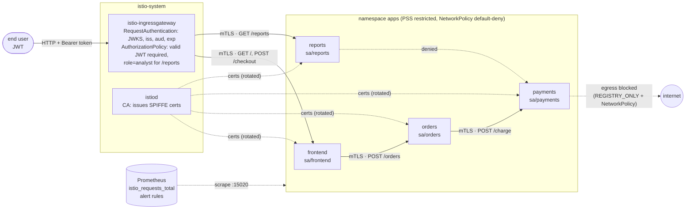

# zero-trust-service-mesh

[](https://github.com/ahmedelgmal310/zero-trust-service-mesh/actions/workflows/ci.yml)
[](LICENSE)

Zero-trust networking for microservices on Kubernetes. Four Go services each run
under their own **SPIFFE identity**. **Istio** enforces **STRICT mTLS** across the
whole mesh. **Default-deny AuthorizationPolicies** allow only the intended
caller → callee pairs, methods and paths. The **ingress gateway** validates end-user
**JWTs**. Egress is limited to the service registry, and **Kubernetes
NetworkPolicies** add a second, independent layer.

Every push to `main` deploys all of it to a throwaway **kind** cluster and runs a
**policy conformance matrix**: 21 ordinary HTTP requests, each with an expected
result (allowed, or denied). If any observed result differs from what is
expected, the job fails. The same job also checks the following:

- workload certificate TTL and live rotation
- the denial alert firing in Prometheus
- mesh latency overhead, measured with fortio

## Contents

- [The problem](#the-problem)
- [Architecture](#architecture)
- [How it works](#how-it-works)
- [Why Istio sidecar mode](#why-istio-sidecar-mode)
- [Policy conformance matrix](#policy-conformance-matrix)
- [Results from CI](#results-from-ci)
- [Observability and alerts](#observability-and-alerts)
- [Supply chain and quality gates](#supply-chain-and-quality-gates)
- [Limitations](#limitations)
- [Runbook](#runbook)
- [Repository layout](#repository-layout)
- [Local development](#local-development)

## The problem

In a flat Kubernetes network, any pod can open a connection to any other pod. Once
traffic is inside the cluster it is trusted by default. So a single misconfigured
or misbehaving workload can call the payments API, read an admin endpoint, or
send data to the internet. IP addresses and labels are not identities: anyone who
can create a pod can choose its labels.

Zero trust replaces "inside the network" with three explicit checks on every
request:

1. **Who is calling?** A cryptographic workload identity from an mTLS
   certificate, plus a verified end-user identity from a JWT at the edge.
2. **Is that caller allowed to do this?** Identity, method and path, deny by
   default.
3. **Where can it go?** In-mesh destinations only, with no route to the internet.

And it is not enough to write these policies down. They have to be **tested like
code**, so a regression fails CI instead of reaching production.

## Architecture



Every arrow is the **only** allowed edge for that pair. Anything else hits the
mesh-wide `allow-nothing` policy (HTTP 403), is refused by STRICT mTLS (connection
reset), or is dropped by a NetworkPolicy (timeout).

## How it works

**Services** ([`internal/`](internal), [`cmd/`](cmd)): Go standard library only,
one distroless image with four binaries. Each service reports the caller identity
that its sidecar saw (the SPIFFE URI in `X-Forwarded-Client-Cert`). This lets the
e2e suite assert the identity at every hop of a real request.

| Service | Endpoints | Called by |
|---|---|---|
| frontend | `GET /`, `POST /checkout` | ingress gateway only |
| orders | `POST /orders`, `GET /orders/{id}` | frontend only (`POST /orders`) |
| payments | `POST /charge`, `GET /admin/refunds` | orders only (`POST /charge`); nobody reaches `/admin/refunds` |
| reports | `GET /reports` | ingress gateway only, for users with `role=analyst` |

`payments` really does serve `/admin/refunds`, and it would answer `DELETE` with
`405`. So when the tests get a `403 RBAC: access denied` instead, the mesh did the
blocking, not the application.

**Controls**, one layer at a time:

| Layer | Object | Effect |
|---|---|---|
| Transport identity | [`PeerAuthentication` STRICT](deploy/mesh/mesh-wide.yaml) (root namespace) | Every sidecar refuses plaintext. Identity = `spiffe://cluster.local/ns/<ns>/sa/<sa>` from a certificate that istiod issues and rotates |
| Default deny | [`AuthorizationPolicy allow-nothing`](deploy/mesh/mesh-wide.yaml) (root namespace) | Every request to every meshed workload, the gateway included, is denied unless an ALLOW policy matches |
| Service-to-service authz | [`authorization.yaml`](deploy/mesh/authorization.yaml) | One ALLOW policy per service: exact principal + method + path |
| End-user identity | [`RequestAuthentication`](deploy/mesh/request-authentication.tmpl.yaml) + [`ingress-require-jwt`](deploy/mesh/ingress.yaml) | Gateway checks signature (inline JWKS), issuer, audience and expiry. A token is mandatory, `role=analyst` is required for `/reports`, and `sub` is forwarded as `X-User` |
| Egress | `outboundTrafficPolicy: REGISTRY_ONLY` ([mesh](deploy/istio/istio-operator.yaml) and [`Sidecar`](deploy/mesh/authorization.yaml)) | Sidecars only route to known services. The `apps` sidecars only see their own namespace and the control plane |
| L3/L4, independent of Istio | [NetworkPolicies](deploy/netpol/apps.yaml) | Default deny in both directions. Allowed: DNS, istiod `:15012`, Prometheus to `:15020`, and the same call graph as the mesh, on port 8080 |
| Pod hardening | [workloads](deploy/apps/workloads.yaml), namespace PSS `restricted` | Non-root, read-only root FS, no capabilities, seccomp `RuntimeDefault`, no API token mounted. istio-cni removes the need for a privileged init container |

**JWT material is never committed.** [`cmd/tokengen`](cmd/tokengen) creates a fresh
RSA-2048 key on every CI run and writes the public JWKS, which
[`e2e/deploy.sh`](e2e/deploy.sh) inlines into the `RequestAuthentication`. It also
writes eight token fixtures: valid customer, valid analyst, expired, forged
(attacker key reusing the real `kid`), wrong issuer, wrong audience, `alg: none`,
and tampered (payload edited after signing). The fixtures are unit-tested in
[`internal/tokens`](internal/tokens) before the mesh ever sees them.

## Why Istio sidecar mode

I chose **Istio 1.31, sidecar mode, with istio-cni** because it is the most
predictable option on kind for what this project has to prove:

- **L7 authorization at every hop with no extra components.** Each sidecar
  enforces method/path AuthorizationPolicies itself. Ambient mode needs a waypoint
  proxy per namespace or service account for the same L7 rules, which adds
  moving parts to a CI cluster.
- **JWT validation is built in** (`RequestAuthentication`). Linkerd has no native
  end-user JWT validation, and its authorization model is route-based but not
  JWT-aware.
- **Egress control is built in** (`REGISTRY_ONLY` plus the `Sidecar` resource).
- **istio-cni** sets up traffic redirection from a node agent rather than a
  `NET_ADMIN` init container, so the application namespace can enforce the
  **`restricted`** Pod Security Standard.
- Istio 1.31 officially supports Kubernetes 1.32–1.37, which covers the kind node
  (v1.36.4).

## Policy conformance matrix

The matrix lives in [`e2e/conformance.tsv`](e2e/conformance.tsv), one row per
case: client pod (identity and namespace), method, URL, token fixture and
expected result. [`e2e/conformance.sh`](e2e/conformance.sh) sends each request
with plain `curl` from a test client pod
([`deploy/conformance/test-clients.yaml`](deploy/conformance/test-clients.yaml))
and compares the result:

- `201`/`200`/`401`/`403`: exactly that status. For 401/403, the body must come
  from the mesh, not the app.
- `denied`: a mesh 401/403, or no connection at all.
- `refused`: the connection itself must fail.

Observed results below are from the [linked green run](#results-from-ci). The
"observed" column names the layer that produced the result.

| Case | Client | Request | Token | Expected | Observed |
|---|---|---|---|---|---|
| End user checks out (gateway → frontend → orders → payments) | `external/test-end-user` | `POST /checkout` | valid-customer | 201 | **201** |
| End user loads the frontend | `external/test-end-user` | `GET /` | valid-customer | 200 | **200** |
| Analyst reads reports | `external/test-end-user` | `GET /reports` | valid-analyst | 200 | **200** |
| orders identity charges a payment | `apps/test-as-orders` | `POST payments/charge` | – | 201 | **201** |
| Pod **without a sidecar** sends plaintext to payments | `apps/test-no-sidecar` | `POST payments/charge` | – | refused | connection reset by the mesh (STRICT mTLS) |
| **reports** identity calls payments | `apps/test-as-reports` | `POST payments/charge` | – | denied | no connection: dropped by NetworkPolicy |
| reports identity calls orders | `apps/test-as-reports` | `POST orders/orders` | – | denied | no connection: dropped by NetworkPolicy |
| orders identity, **wrong method** | `apps/test-as-orders` | `DELETE payments/charge` | – | 403 | **403** RBAC: access denied |
| orders identity, **wrong path** | `apps/test-as-orders` | `GET payments/admin/refunds` | – | 403 | **403** RBAC: access denied |
| Meshed pod in **another namespace** calls orders | `other/test-other-ns` | `POST orders/orders` | – | denied | no connection: dropped by NetworkPolicy |
| Meshed pod in another namespace calls payments | `other/test-other-ns` | `POST payments/charge` | – | denied | no connection: dropped by NetworkPolicy |
| **Outbound request to an external host** | `apps/test-as-orders` | `GET https://example.com/` | – | refused | connection reset by the sidecar (REGISTRY_ONLY) |
| Checkout with **no token** | `external/test-end-user` | `POST /checkout` | – | 403 | **403** RBAC: access denied |
| **Expired** token | `external/test-end-user` | `POST /checkout` | expired | 401 | **401** Jwt is expired |
| **Forged** token (untrusted key, real `kid`) | `external/test-end-user` | `POST /checkout` | forged | 401 | **401** Jwt verification fails |
| Untrusted **issuer** | `external/test-end-user` | `POST /checkout` | wrong-issuer | 401 | **401** Jwt issuer is not configured |
| Wrong **audience** | `external/test-end-user` | `POST /checkout` | wrong-audience | denied | **403** audience not allowed (RequestAuthentication) |
| Unsigned token (`alg: none`) | `external/test-end-user` | `POST /checkout` | alg-none | 401 | **401** Jwt is not in the form of Header.Payload.Signature |
| **Tampered** payload (role edited to analyst) | `external/test-end-user` | `GET /reports` | tampered | 401 | **401** Jwt verification fails |
| Valid token, missing `role=analyst` | `external/test-end-user` | `GET /reports` | valid-customer | 403 | **403** RBAC: access denied |
| Valid token, path not exposed at the edge | `external/test-end-user` | `GET /admin/refunds` | valid-customer | 403 | **403** RBAC: access denied |

**21/21 cases matched.** The matrix also shows defence in depth working. The
no-sidecar pod carries the `orders` role label, so the NetworkPolicy lets it
through, and STRICT mTLS still refuses it: labels can be copied, certificates
cannot. For the reports and cross-namespace cases, the NetworkPolicy drops the
connection before the sidecar ever sees it. An AuthorizationPolicy default-deny
stands behind it as the second layer.

For the allowed checkout, the suite also asserts the identity seen at every hop:

```json
{
  "gateway_to_frontend": "spiffe://cluster.local/ns/istio-system/sa/istio-ingressgateway-service-account",
  "frontend_to_orders": "spiffe://cluster.local/ns/apps/sa/frontend",
  "orders_to_payments": "spiffe://cluster.local/ns/apps/sa/orders",
  "user": "alice"
}
```

## Results from CI

These numbers come from CI run
[#40609194984](https://github.com/ahmedelgmal310/zero-trust-service-mesh/actions/runs/40609194984)
on `main` (commit `3a2e996`). The cluster was kind v0.33.0 with Kubernetes v1.36.4,
Istio 1.31.1, Prometheus v3.15.0 (10 s scrape and evaluation) and fortio 1.75.3,
on a standard `ubuntu-latest` runner. Each run uploads its own numbers as the
`e2e-results` artifact and posts them in the job summary.

| Check | Measured |
|---|---|
| Policy conformance matrix | **21/21** cases as expected (4 allowed, 17 denied) |
| Requests to `apps` workloads over mTLS / without mTLS (Prometheus) | **1455 / 0** |
| Workload cert TTL, default workloads | **24 h** (`notAfter − notBefore` = 86 520 s, which includes the CA's 2-minute backdated `notBefore`) |
| Workload cert TTL, payments (shortened to 2 m in CI) | **2 m** requested (240 s validity window) |
| payments certificate rotations in a 180 s window | **3** (a new serial about every 60 s, at 50% of TTL) |
| Checkout requests through the full chain during rotation | **349 ok, 0 failed** |
| `AuthorizationDenialsSpike` alert after 400 denied requests | **fired**, 30 s after the burst ended (rule: > 0.2 denials/s over 5 m, `for: 1m`) |
| 403 denials recorded by `apps` sidecars | 402 (400 burst + 2 matrix cases) |
| `istioctl analyze -A` | no errors, no warnings (the job fails on warnings) |
| Go test coverage (`-race`) | 85.0% (gate 80%) |

**Latency overhead.** fortio load against a fortio echo server, with the same
client and server, at 200 qps and 4 connections, 60 s per run. There were 2 rounds
per mode, alternating, after a 5 s warm-up. The values below are the median of
the 2 rounds. "mesh" means client sidecar → mTLS → server sidecar with an
identity-based AuthorizationPolicy. Every request in every run returned 200.

| Mode | p50 | p90 | p95 | p99 |
|---|---|---|---|---|
| no mesh (`bench-plain`) | 0.530 ms | 0.907 ms | 0.954 ms | 0.991 ms |
| mesh (`bench-mesh`) | 1.501 ms | 1.909 ms | 1.960 ms | 2.162 ms |
| **overhead** | **+0.97 ms** | +1.00 ms | **+1.01 ms** | +1.17 ms |

This is two sidecar hops plus a TLS session per connection, on a shared 4-vCPU
runner, with the client, both proxies and the server on one node. Runner noise
matters. The previous green run on the same code
([#40607756616](https://github.com/ahmedelgmal310/zero-trust-service-mesh/actions/runs/40607756616))
measured **+0.22 ms p50 / +0.07 ms p95**. Treat the result as "about 1 ms per
mesh hop, or less", not as a precise constant. See [Limitations](#limitations).

## Observability and alerts

Istio injection annotates every sidecar pod for scraping. Prometheus reads the
merged metrics on `:15020` (the NetworkPolicy allows exactly that port from the
`monitoring` namespace). The rules in [`observability/alerts.yaml`](observability/alerts.yaml)
are unit-tested with `promtool test rules`
([`alerts_test.yaml`](observability/alerts_test.yaml)) and also loaded into the
in-cluster Prometheus, where the e2e job waits for one of them to fire for real.

| Alert | Fires when | Why |
|---|---|---|
| `AuthorizationDenialsSpike` (warning) | > 0.2 403s/s for one source→destination pair over 5 m, for 1 m | A workload keeps calling something its identity is not allowed to: a bad deploy, a policy regression, or a misbehaving workload |
| `IngressAuthFailuresHigh` (warning) | > 25% of gateway requests are 401/403 and > 0.1/s, for 5 m | Broken token issuer, clock skew, or credential stuffing at the edge |
| `PlaintextTrafficAccepted` (critical) | Any request recorded with `connection_security_policy != mutual_tls` | Must never happen under STRICT. It means someone loosened a PeerAuthentication |

The promtool tests cover both sides of each rule: firing, staying quiet below the
threshold, and the minimum-volume guard on the ratio alert.

## Supply chain and quality gates

| Gate | Job | Fails the build when |
|---|---|---|
| `go vet`, `go test -race` | `go` | vet finding, failing or racy test |
| Coverage | `go` | total statement coverage < 80% |
| govulncheck | `go` | a reachable known vulnerability |
| golangci-lint v2 (gosec, errorlint, revive, noctx, ...) | `golangci-lint` | any finding |
| Gitleaks (full history) | `static` | secret detected |
| shellcheck, actionlint, hadolint | `static` | script, workflow or Dockerfile issue |
| kubeconform `-strict` with Istio CRD schemas | `manifests` | invalid Kubernetes or Istio object |
| `istioctl analyze` (offline, and live with `-A`) | `manifests`, `e2e` | analyzer error (offline) or warning (live) |
| promtool `check rules` + `test rules` | `manifests` | invalid rule or failing alert unit test |
| Trivy (HIGH/CRITICAL, fixed) | `image` | fixable HIGH/CRITICAL vulnerability |
| kind e2e | `e2e` | any conformance mismatch, no cert rotation, a request failing during rotation, alert not firing, any non-mTLS request, fortio errors |

Other controls:

- Every action is pinned to a full commit SHA. Images are pinned by digest,
  including the Istio control plane, proxy and CNI images. The Istio tarball and
  kubeconform are verified by SHA-256.
- Every version is at least two weeks old, and Dependabot uses a 14-day cooldown.
  The full list is in [`docs/versions.md`](docs/versions.md).
- Workflows default to `contents: read`, and no job needs more.
- istiod blocks all remote JWKS fetches (`BLOCKED_CIDRS_IN_JWKS_URIS`), because
  the JWKS is inline.

## Limitations

Honest scope notes:

- **Istio 1.31.1 has known CVEs.** 1.31.2 (2026-10-16) and 1.31.3 (2026-10-22) are
  security patch releases. Istio lists 1.31.3+ as having no known CVEs. Both
  releases are still inside this repository's two-week version-age window, so CI
  runs 1.31.1 on a cluster that exists only for the job. The next update
  (Dependabot or manual) must adopt 1.31.3+ once it passes the window
  (2026-11-05). A production mesh should fast-track security patches.
- **Plain HTTP at the edge.** The gateway listens on HTTP inside the CI cluster.
  In production it would terminate TLS (cert-manager) and redirect HTTP.
- **JWKS is inline and static per run.** There is no real identity provider, and
  key rotation of the *signing* key is not exercised. Production would use
  `jwksUri` against the IdP with an allow-listed CIDR.
- **Single-node kind, shared runner.** The latency numbers include runner noise
  (two green runs on the same code: +0.22 ms and +0.97 ms p50). The benchmark is a
  fixed-rate echo test, not a realistic payload or a saturation test, and it does
  not measure proxy CPU or memory.
- **The 2-minute certificate TTL is CI-only** (payments only), so rotation is
  visible within one job. Other workloads keep the 24 h default.
- **DNS is not restricted** beyond "pods may query kube-dns". REGISTRY_ONLY and
  the NetworkPolicy stop connections to external hosts, but they do not stop DNS
  lookups.
- **NetworkPolicy enforcement depends on the CNI** (here, kindnet's
  kube-network-policies). On another CNI, re-run the matrix. That is what it is
  for.
- **One trust domain, one cluster.** There is no multi-cluster federation and no
  external CA (istiod's self-signed root). Production would plug in an
  intermediate CA from a managed PKI.
- **Telemetry granularity.** HTTP-level rejections are visible in `istio_requests_total`
  (the CI run recorded the gateway 401/403s). mTLS handshake failures (plaintext attempts) do
  not show up as HTTP metrics, so they are covered by the conformance matrix,
  not by an alert.

## Runbook

All commands assume `kubectl` access and `istioctl` 1.31.x.

**A legitimate call started failing with `403 RBAC: access denied`**

```sh
kubectl -n apps logs deploy/<callee> -c istio-proxy --tail=50 | grep '"response_code":403'
istioctl x authz check deploy/<callee> -n apps          # which policies apply to the callee
kubectl -n apps get authorizationpolicy -o yaml
```

Check the caller's principal (`spiffe://cluster.local/ns/<ns>/sa/<sa>`). Did it
change its ServiceAccount? Then check the method and path. Fix the policy in git,
add a row to `e2e/conformance.tsv` for the new edge, and let CI prove it.

**`AuthorizationDenialsSpike` fired**

1. Read `source_workload` and `destination_workload` from the alert.
2. Check whether the source was just deployed (`kubectl -n <ns> rollout history`).
   If so, roll it back or fix its configuration (wrong upstream URL, new endpoint
   with no policy).
3. If nothing changed, treat the source as suspect. Isolate it by scaling it to 0
   or applying a deny policy for its principal, keep its logs, and investigate.

**`IngressAuthFailuresHigh` fired**

Check the gateway logs for the failure reason:

```sh
kubectl -n istio-system logs deploy/istio-ingressgateway --tail=200 | grep -E '"response_code":(401|403)'
```

- `Jwt is expired` from many users means issuer clock skew or a long-lived client
  cache.
- `Jwt verification fails` means the IdP rotated its key and the JWKS is stale.
- A flood from few sources means rate limiting is needed at the edge.

**`PlaintextTrafficAccepted` fired**

```sh
kubectl get peerauthentication -A
```

Some PeerAuthentication is `PERMISSIVE` or `DISABLE`. Revert it. STRICT in the
root namespace is the source of truth.

**Inspect a workload's certificate and rotation**

```sh
istioctl proxy-config secret deploy/payments -n apps -o json \
  | jq -r '.dynamicActiveSecrets[] | select(.name=="default") | .secret.tlsCertificate.certificateChain.inlineBytes' \
  | base64 -d | openssl x509 -noout -serial -dates -ext subjectAltName
```

**Egress is needed for a new external dependency**

Do not switch to `ALLOW_ANY`. Add a `ServiceEntry` for the exact host, route it
through an egress gateway if it must be audited, open the NetworkPolicy egress to
that destination, and add an allowed row plus a "different host is still
refused" row to the matrix.

## Repository layout

```
cmd/{frontend,orders,payments,reports}/  service entrypoints
cmd/tokengen/                            per-run JWT key, JWKS and token fixtures
internal/                                handlers, mesh identity parsing, token minting (+ tests)
deploy/istio/                            IstioOperator: sidecar + istio-cni, REGISTRY_ONLY, pinned images
deploy/apps/                             namespace (PSS restricted), ServiceAccounts, Deployments, Services
deploy/mesh/                             STRICT mTLS, allow-nothing, per-service authz, gateway, JWT
deploy/netpol/                           NetworkPolicies (second layer)
deploy/conformance/                      curl test clients for the conformance matrix
deploy/bench/                            fortio client/server with and without the mesh
observability/                           alert rules, promtool tests, Prometheus values
e2e/                                     setup, deploy, conformance, certs, observability, bench, report
docs/versions.md                         every pinned version and digest
```

## Local development

```sh
go test -race ./...
go run ./cmd/tokengen -out /tmp/jwt       # jwks.json + *.jwt fixtures
promtool test rules observability/alerts_test.yaml
```

To run the whole suite on your own kind cluster (Docker, kind, kubectl, helm, jq,
openssl):

```sh
kind create cluster --name zt --image kindest/node:v1.36.4
docker build -t zt-shop:e2e . && kind load docker-image zt-shop:e2e --name zt
./e2e/install-istioctl.sh
./e2e/setup.sh && ./e2e/deploy.sh
./e2e/conformance.sh && ./e2e/certs.sh && ./e2e/observability.sh && ./e2e/bench.sh
./e2e/report.sh                            # results in e2e-results/
```

## License

[MIT](LICENSE) © 2026 Ahmed Elgamal
